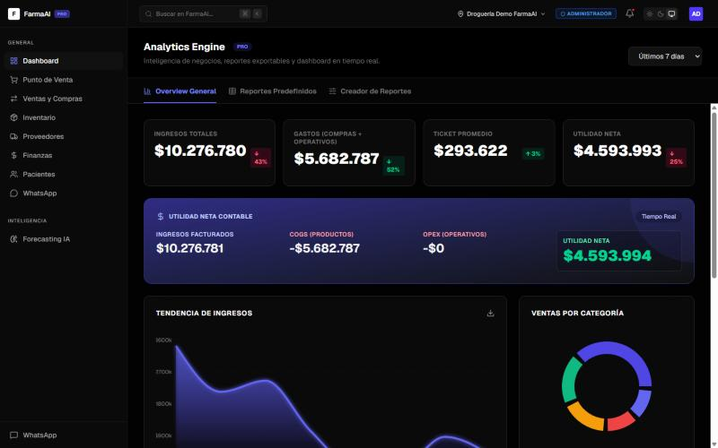
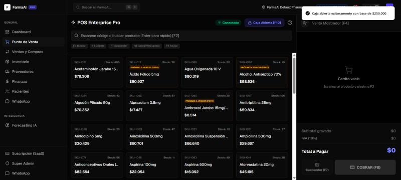
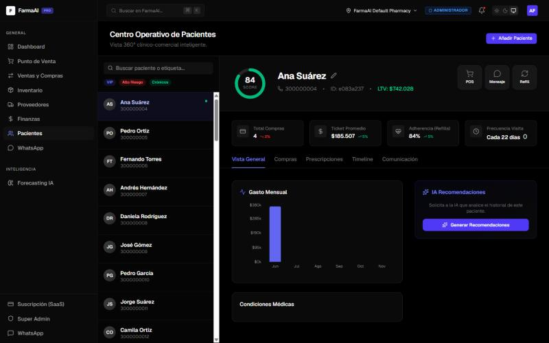
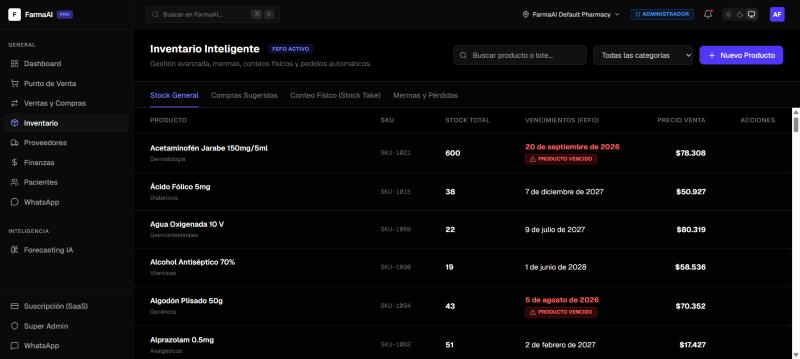
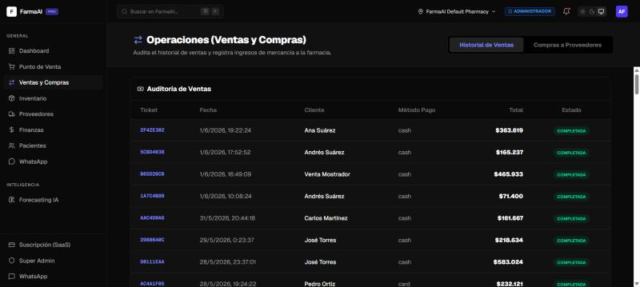
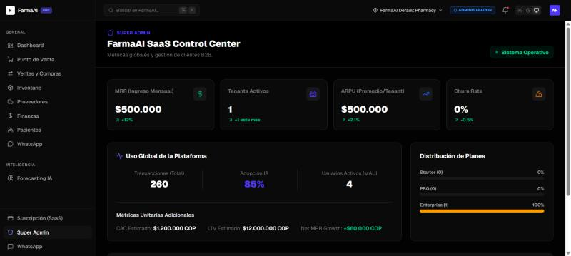
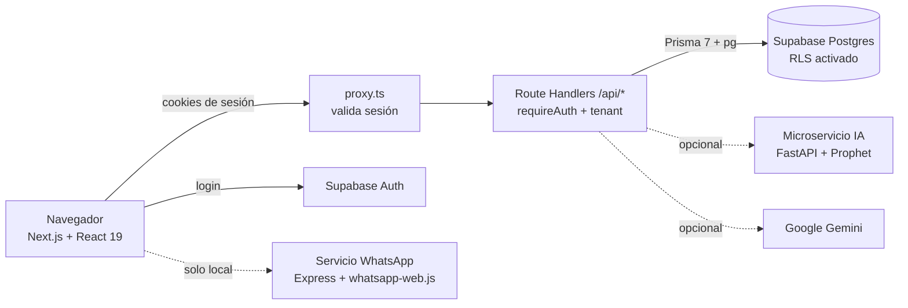

<div align="center">

# 💊 FarmaAI — CRM y POS inteligente para droguerías

**Plataforma SaaS multi-farmacia** con punto de venta, inventario FEFO, CRM de pacientes,
finanzas, pronóstico de demanda con IA y panel de administración SaaS.

[](https://github.com/Tiago013/CRMFARMACIA/actions/workflows/ci.yml)


### 🔗 [Ver demo en vivo → crmfarmacia.vercel.app](https://crmfarmacia.vercel.app)

</div>

---

## 📑 Contenido

- [Probar la demo (2 minutos)](#-probar-la-demo-2-minutos)
- [El problema y la solución](#-el-problema-y-la-solución)
- [Funcionalidades](#-funcionalidades)
- [Capturas](#-capturas)
- [Arquitectura](#️-arquitectura)
- [Seguridad](#-seguridad)
- [Ejecutarlo en local](#-ejecutarlo-en-local)
- [Pruebas](#-pruebas)
- [Estructura del repositorio](#-estructura-del-repositorio)
- [Decisiones técnicas y aprendizajes](#-decisiones-técnicas-y-aprendizajes)
- [Trabajo futuro](#-trabajo-futuro)

---

## 🚀 Probar la demo (2 minutos)

1. Abre **https://crmfarmacia.vercel.app**
2. Inicia sesión con la cuenta de demostración:

   | Usuario | Contraseña | Rol |
   |---|---|---|
   | `demo@farmaai.com` | `123456` | Cajero (solo operación) |

3. Recorrido sugerido:
   - **Pacientes** → abre un paciente y mira su ficha 360° (historial, gasto mensual, alergias).
   - **Punto de Venta** → *Realizar Apertura de Caja* → agrega productos → cobra.
   - **Inventario** → lotes ordenados por vencimiento (FEFO) y alertas de productos vencidos.
   - **Ventas y Compras** → auditoría de tickets.
   - **Dashboard / Finanzas** → cambia el filtro a **"Año"** para ver los meses de datos simulados.

> ℹ️ Todos los datos (pacientes, productos, ventas) son **ficticios**. La cuenta demo trabaja en su propia farmacia,
> que **se restaura cada noche**: puedes vender, registrar pacientes o desordenar lo que quieras.
> La cuenta demo tiene rol **cajero**: puede consultar todos los módulos del recorrido, vender y registrar pacientes, pero no borrar productos,
> cambiar precios, hacer reembolsos ni modificar la configuración (el servidor lo impide).

---


## 🎯 El problema y la solución

Las droguerías de barrio en Colombia suelen manejar ventas, inventario y clientes en
herramientas separadas (o en papel). Eso provoca **pérdidas por medicamentos vencidos**,
quiebres de stock y cero seguimiento a pacientes crónicos.

**FarmaAI** integra todo en una sola plataforma web:

- Vende rápido desde un **POS** con control de caja.
- Descuenta inventario por **lotes FEFO** (*First Expired, First Out*): siempre sale primero lo que vence antes.
- Mantiene una **ficha clínico-comercial** de cada paciente (alergias, EPS, compras).
- Calcula **P&L, costo de ventas y gastos** automáticamente.
- **Pronostica la demanda** y sugiere compras a proveedores.
- Es **multi-tenant**: varias farmacias usan la misma instancia sin ver los datos de las demás.

---

## ✨ Funcionalidades

| Módulo | Qué hace |
|---|---|
| 🧾 **Punto de Venta** | Apertura/cierre de caja con denominaciones, carrito, descuentos por línea, IVA 19 % y cobro. El total se **recalcula en el servidor** con los precios de la base de datos. |
| 📦 **Inventario FEFO** | Lotes con fecha de vencimiento, descuento automático del lote más próximo a vencer, ajustes, conteo físico y compras sugeridas. |
| 👥 **CRM de pacientes** | Ficha 360°: datos clínicos, historial de compras, gasto mensual, etiquetas (VIP, crónicos, alto riesgo) y recomendaciones con IA. |
| 🔄 **Ventas y compras** | Auditoría de tickets, reembolsos (devuelven el stock al lote original) y entrada de mercancía por proveedor. |
| 💰 **Finanzas** | Estado de resultados (P&L), gastos operativos por categoría y costo de ventas (COGS). |
| 📈 **Pronóstico (IA)** | Demanda proyectada a 15 días por producto (microservicio Prophet en Python, con respaldo matemático si no está disponible). |
| 💬 **WhatsApp** | Plantillas y automatizaciones de mensajes (servicio local con `whatsapp-web.js`). |
| 🏢 **SaaS / Super Admin** | MRR, tenants activos, planes (Starter / Pro / Enterprise) y suplantación de farmacias para soporte. |
| ⚙️ **Configuración** | Datos legales de la farmacia, logo, usuarios y roles (admin, regente, cajero). |

---

## 📸 Capturas

**Dashboard de analítica**: ingresos, gastos, utilidad neta y tendencia de ventas.



| Punto de Venta | CRM de pacientes (ficha 360°) |
|---|---|
|  |  |

| Inventario FEFO | Auditoría de ventas |
|---|---|
|  |  |

**Panel Super Admin (SaaS)**: MRR, tenants, adopción y distribución de planes.



---

## 🏗️ Arquitectura



| Capa | Tecnología |
|---|---|
| Frontend | Next.js 16 (App Router, Turbopack), React 19, Tailwind CSS 4, Recharts, Zustand, TanStack Query |
| Backend | Route Handlers de Next.js (API REST), Prisma 7 con adaptador `pg` |
| Base de datos | PostgreSQL en Supabase, con Row Level Security |
| Autenticación | Supabase Auth (cookies SSR con `@supabase/ssr`) |
| IA | Google Gemini (recomendaciones), FastAPI + Prophet (pronóstico, `crm-farma-ai-engine/`) |
| Infraestructura | Vercel (app), Supabase (BD + Auth), GitHub Actions (CI: type check + build) |

**Modelo multi-tenant:** cada tabla tiene `tenant_id`. El tenant **nunca** se toma del cliente:
`requireAuth()` lo resuelve en el servidor a partir del perfil del usuario autenticado, y todas las
consultas filtran por él.

---

## 🔐 Seguridad

El proyecto pasó por una auditoría de seguridad completa. Medidas implementadas:

- **Autenticación en todas las rutas API** (`src/lib/auth.ts` → `requireAuth()`), validando el JWT con Supabase (`getUser()`), más una segunda barrera en `proxy.ts`.
- **Aislamiento entre farmacias**: el `tenant_id` sale del perfil en la base de datos; las rutas `[id]` verifican pertenencia antes de leer o modificar.
- **Control por roles**: acciones sensibles (precios, borrados, reembolsos, compras, gastos, configuración) solo para `admin` / `regente`.
- **Row Level Security** en las 20 tablas de Supabase: la clave pública `anon` no puede leer ni escribir datos.
- **Precios calculados en el servidor** en el POS: el cliente no puede alterar el total.
- **Sin XSS**: no se usa `dangerouslySetInnerHTML`; el contenido de usuarios e IA se renderiza como texto.
- **Subida de archivos validada** por firma binaria (PNG/JPG), tamaño máximo y rol.
- **Servicio de WhatsApp** limitado a `127.0.0.1` y a orígenes permitidos.
- **Sin secretos en el código**: todo por variables de entorno (ver `frontend/.env.example`).
- **Dependencias** auditadas con `npm audit` y Next.js en versión parcheada.

---

## 💻 Ejecutarlo en local

### Requisitos
- **Node.js 20.9+** (recomendado 22)
- Una cuenta gratuita de **[Supabase](https://supabase.com)**

### 1. Clonar e instalar

```bash
git clone https://github.com/Tiago013/CRMFARMACIA.git
cd CRMFARMACIA/frontend
npm install
```

### 2. Configurar Supabase
1. Crea un proyecto nuevo en Supabase.
2. Copia `frontend/.env.example` a **`frontend/.env`** y rellena los valores:

| Variable | Dónde encontrarla en Supabase |
|---|---|
| `NEXT_PUBLIC_SUPABASE_URL` | Project Settings → API → Project URL |
| `NEXT_PUBLIC_SUPABASE_ANON_KEY` | Project Settings → API → clave `anon` public |
| `DATABASE_URL` | Project Settings → Database → Connection string → *Transaction pooler* (puerto 6543) |

> Si tu contraseña tiene caracteres especiales, codifícalos en la URL (`:` → `%3A`, `@` → `%40`, `!` → `%21`).

### 3. Crear las tablas y cargar datos de ejemplo

```bash
npx prisma db push
```

```bash
npx tsx --env-file=.env prisma/seed_masivo.ts
```

> ⚠️ `seed_masivo.ts` **borra todos los datos** de la base antes de sembrar. Úsalo solo en tu propio proyecto de pruebas.
> Genera 1 farmacia, 50 pacientes, 100 productos, 5 proveedores y 6 meses de compras y ventas.

Después, en Supabase → **SQL Editor**, ejecuta el contenido de [`frontend/prisma/enable_rls.sql`](frontend/prisma/enable_rls.sql) para activar Row Level Security.

### 4. Crear tu usuario
1. Supabase → **Authentication → Users → Add user → Create new user** (marca *Auto Confirm User*).
2. En **SQL Editor**, dale un perfil de administrador (cambia el correo):

```sql
insert into public.user_profiles (id, auth_id, tenant_id, first_name, last_name, role, created_at, updated_at)
select gen_random_uuid()::text, u.id::text, (select id from public.pharmacies limit 1),
       'Admin', 'Demo', 'admin', now(), now()
from auth.users u where u.email = 'TU-CORREO@ejemplo.com';
```

Roles disponibles: `admin`, `regente`, `cajero`. Para acceder además al panel **Super Admin**:

```sql
insert into public.system_admins (id, auth_id, email, first_name, last_name, created_at, updated_at)
select gen_random_uuid()::text, id::text, email, 'Super', 'Admin', now(), now()
from auth.users where email = 'TU-CORREO@ejemplo.com';
```

### 5. Arrancar

```bash
npm run dev
```

Abre http://localhost:3000 e inicia sesión.

### Servicios opcionales

| Servicio | Cómo activarlo |
|---|---|
| Recomendaciones con Gemini | Añade `GEMINI_API_KEY` en `.env` |
| Pronóstico con Prophet | En `crm-farma-ai-engine/`: `pip install fastapi uvicorn pandas prophet` y `uvicorn main:app --port 8000` |
| WhatsApp | `npm run whatsapp` y escanea el QR (solo en local) |

---

## 🧪 Pruebas

```bash
cd frontend
npm test                 # pruebas unitarias (Vitest)
npm run test:coverage    # con reporte de cobertura
npm run e2e              # recorrido demo con Playwright (contra la demo pública)
```

Cubren la lógica donde un error cuesta dinero o expone datos:

| Módulo | Qué se prueba |
|---|---|
| `lib/pos/pricing.ts` | Descuento por línea, IVA 19 %, redondeo a centavos y validación de cantidades. El POS y el servidor usan la **misma función**, así el total que ve el cajero es el que se cobra. |
| `lib/inventory/fefo.ts` | Selección del lote que vence primero, reparto entre lotes, sobreventa y devolución exacta a cada lote en un reembolso. |
| `lib/auth.ts` | Aislamiento entre farmacias (el tenant nunca sale del cliente), permisos por rol (un cajero recibe 403 en acciones de administrador) y suplantación del superadmin. |

El CI ejecuta las pruebas en cada PR y **falla si la cobertura de esta lógica baja del 80 %**; el resumen aparece en la pestaña *Summary* de cada ejecución.

Además, el workflow **E2E demo** recorre la demo pública cada mañana, después de la restauración nocturna, igual que lo haría un reclutador: login, pacientes, venta en el POS, auditoría, inventario y dashboard. Se puede lanzar a mano desde *Actions* contra cualquier URL, por ejemplo la vista previa de un PR en Vercel.

---

## 📂 Estructura del repositorio

```
CRMFARMACIA/
├── frontend/                  # Aplicación Next.js (lo que se despliega en Vercel)
│   ├── src/
│   │   ├── app/(dashboard)/   # Pantallas: POS, CRM, inventario, finanzas, SaaS...
│   │   ├── app/api/           # API REST (Route Handlers)
│   │   ├── lib/auth.ts        # requireAuth(): sesión + tenant + roles
│   │   ├── lib/pos/           # Cálculo de la venta (compartido POS ↔ servidor)
│   │   ├── lib/inventory/     # Asignación FEFO y reembolsos
│   │   ├── proxy.ts           # Barrera de sesión para páginas y API
│   │   └── stores/            # Estado global (Zustand)
│   ├── prisma/                # Esquema, semillas y enable_rls.sql
│   ├── prisma/sql/            # Migración a Decimal y restauración nocturna de la demo
│   ├── tests/unit/            # Pruebas Vitest
│   └── scripts/               # Servicio local de WhatsApp
├── crm-farma-ai-engine/       # Microservicio de pronóstico (FastAPI + Prophet)
├── docs/                      # Arquitectura y capturas
├── legal/                     # Términos y política de privacidad
└── .github/workflows/ci.yml   # CI: type check + pruebas + build
```

---

## 🧠 Decisiones técnicas y aprendizajes

- **Monolito modular con Next.js**: frontend y API en un solo despliegue, más simple de operar para un equipo pequeño. La evolución a microservicios está planteada en [`docs/architecture_evolution.md`](docs/architecture_evolution.md).
- **FEFO en vez de FIFO**: en farmacia importa más la fecha de vencimiento que la de llegada.
- **Dinero en `NUMERIC`, no en `Float`**: los montos se guardan exactos en la base y el cálculo de la venta vive en una sola función compartida por el POS y el servidor.
- **Demo que se restaura sola**: una función de Postgres copia cada noche una foto de los datos a la farmacia demo, con IDs nuevos y fechas movidas al día actual, así los gráficos de “últimos 7 días” nunca salen vacíos.
- **Multi-tenancy por columna** (`tenant_id`) + RLS: el modelo más económico para un SaaS que empieza, con aislamiento verificado en cada consulta.
- **Seguridad aprendida en el proceso**: la primera versión confiaba en el cliente (tenant, precios). Una auditoría detectó y corrigió endpoints sin autenticación, credenciales en el repositorio y tablas expuestas. Los PR #1 a #3 documentan esas correcciones.

---

## 🔭 Trabajo futuro

- Facturación electrónica DIAN.
- Políticas RLS por tenant para usar Supabase Realtime directamente desde el cliente.
- Desplegar el servicio de WhatsApp y el motor de IA como servicios gestionados.

---

<div align="center">
Hecho con 💊 y ☕ como proyecto universitario.
</div>
