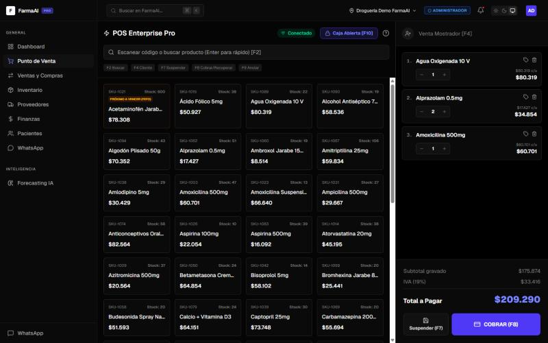
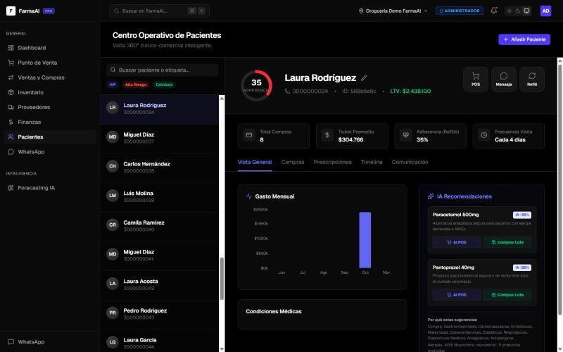
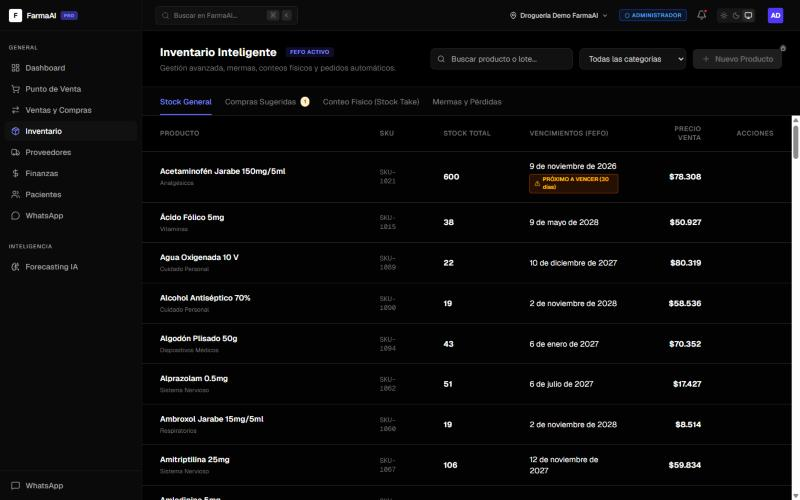
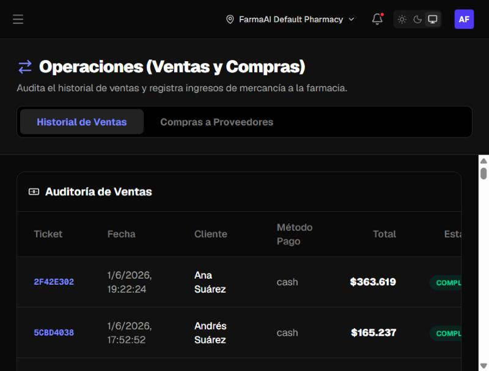
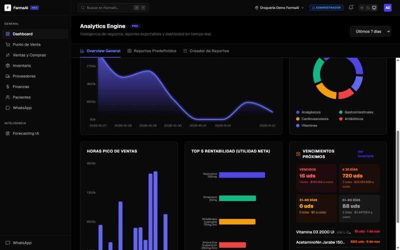
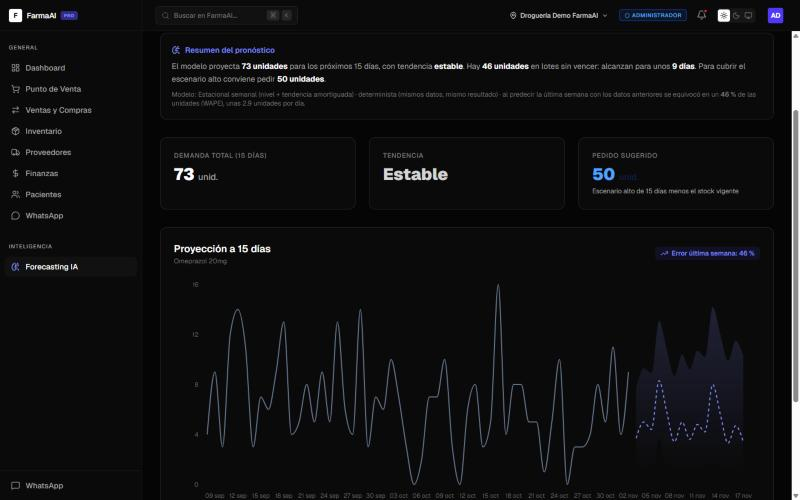
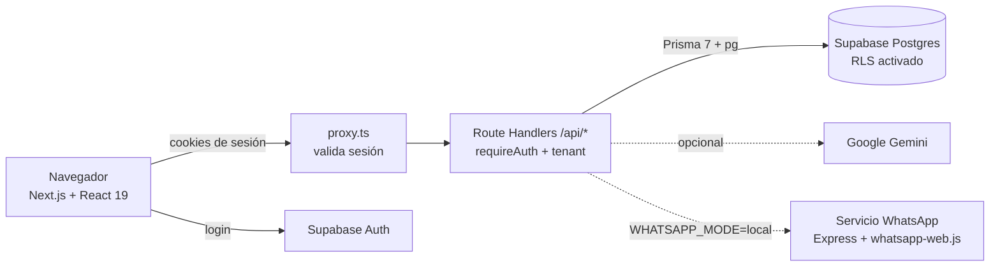

<div align="center">

# 💊 FarmaAI — CRM y POS inteligente para droguerías

**Plataforma SaaS multi-farmacia** con punto de venta, inventario FEFO, CRM de pacientes,
finanzas, pronóstico de demanda y panel de administración SaaS.

[](https://github.com/Tiago013/CRMFARMACIA/actions/workflows/ci.yml)


### 🔗 [Ver demo en vivo → crmfarmacia.vercel.app](https://crmfarmacia.vercel.app)

</div>

---

## 📑 Contenido

- [Probar la demo (2 minutos)](#-probar-la-demo-2-minutos)
- [El problema y la solución](#-el-problema-y-la-solución)
- [Funcionalidades](#-funcionalidades)
- [Capturas](#-capturas)
- [Arquitectura](#️-arquitectura)
- [Seguridad](#-seguridad)
- [Ejecutarlo en local](#-ejecutarlo-en-local)
- [Pruebas](#-pruebas)
- [Estructura del repositorio](#-estructura-del-repositorio)
- [Caso de estudio: de MVP a demo confiable](#-caso-de-estudio-de-mvp-a-demo-confiable)
- [Decisiones técnicas y aprendizajes](#-decisiones-técnicas-y-aprendizajes)
- [Trabajo futuro](#-trabajo-futuro)

---

## 🚀 Probar la demo (2 minutos)

1. Abre **https://crmfarmacia.vercel.app** y pulsa **"Probar la demo"**: entras como cajero, sin escribir nada,
   con un **recorrido guiado** de 6 pasos (se puede repetir desde la franja superior).
2. Para probar otro rol, elígelo en la página de inicio o en *Iniciar sesión → Probar la demo*:

   | Rol | Usuario | Qué puede hacer |
   |---|---|---|
   | Cajero | `demo@farmaai.com` | Vender, abrir y cerrar caja, registrar pacientes |
   | Regente | `regente.demo@farmaai.com` | Además: inventario, conteo físico, mermas, compras y reembolsos |
   | Administrador | `admin.demo@farmaai.com` | Ve todo, incluida la configuración, en **solo lectura** |

   Contraseña de las tres: `123456`. Las acciones que tu rol no permite aparecen deshabilitadas con un candado.

3. Recorrido sugerido:
   - **Pacientes** → abre un paciente y mira su ficha 360° (historial, gasto mensual, alergias).
   - **Punto de Venta** → *Realizar Apertura de Caja* → elige un paciente → agrega productos → cobra.
   - **WhatsApp** → el recibo de esa venta aparece en la bandeja, marcado **Modo demo** (no se envía nada).
   - **Inventario** → lotes ordenados por vencimiento (FEFO) y alertas de productos vencidos.
   - **Ventas y Compras** → auditoría de tickets y **Cierre del día (Z)**, exportable a Excel y PDF.
   - **Dashboard / Finanzas** → cambia el filtro a **"Año"** para ver los meses de datos simulados.

> ℹ️ Todos los datos (pacientes, productos, ventas) son **ficticios**. La cuenta demo trabaja en su propia farmacia,
> que **se restaura cada noche**: puedes vender, registrar pacientes o desordenar lo que quieras.
> Los permisos se validan en el servidor: aunque un botón se habilitara a mano, la API responde 403.

---


## 🎯 El problema y la solución

Las droguerías de barrio en Colombia suelen manejar ventas, inventario y clientes en
herramientas separadas (o en papel). Eso provoca **pérdidas por medicamentos vencidos**,
quiebres de stock y cero seguimiento a pacientes crónicos.

**FarmaAI** integra todo en una sola plataforma web:

- Vende rápido desde un **POS** con control de caja.
- Descuenta inventario por **lotes FEFO** (*First Expired, First Out*): siempre sale primero lo que vence antes.
- Mantiene una **ficha clínico-comercial** de cada paciente (alergias, EPS, compras).
- Calcula **P&L, costo de ventas y gastos** automáticamente.
- **Pronostica la demanda** y sugiere compras a proveedores.
- Es **multi-tenant**: varias farmacias usan la misma instancia sin ver los datos de las demás.

---

## ✨ Funcionalidades

| Módulo | Qué hace |
|---|---|
| 🧾 **Punto de Venta** | Apertura/cierre de caja con denominaciones, carrito, descuentos por línea, IVA 19 % y cobro. El total se **recalcula en el servidor** con los precios de la base de datos. |
| 📦 **Inventario FEFO** | Lotes con fecha de vencimiento, descuento automático del lote más próximo a vencer, ajustes, conteo físico y compras sugeridas. |
| 👥 **CRM de pacientes** | Ficha 360°: datos clínicos, historial de compras, gasto mensual, etiquetas (VIP, crónicos, alto riesgo) y recomendaciones con IA. |
| 🔄 **Ventas y compras** | Auditoría de tickets, reembolsos (devuelven el stock al lote original), entrada de mercancía por proveedor y **cierre del día (reporte Z)**: ventas, medios de pago, devoluciones y cuadre de cada turno de caja. |
| 📊 **Reportes** | Productos más vendidos, pacientes VIP, riesgo de abandono, inventario estancado y un creador de reportes. Todo se exporta a **Excel y PDF**, incluido el reporte Z. |
| 💰 **Finanzas** | Estado de resultados (P&L), gastos operativos por categoría y costo de ventas (COGS). |
| 📈 **Pronóstico** | Demanda a 15 días por producto con un modelo estacional semanal determinista; muestra cuánto se equivocó al predecir la última semana (WAPE) y sugiere cuánto pedir según el stock vigente. |
| 💬 **WhatsApp** | Recibo automático al cobrar y mensajes con plantilla desde la ficha del paciente. En la demo pública los mensajes quedan en una bandeja simulada; en local se envían con `whatsapp-web.js`. |
| 🏢 **SaaS / Super Admin** | MRR, tenants activos, planes (Starter / Pro / Enterprise) y suplantación de farmacias para soporte. El cobro con pasarela está [diseñado, no implementado](docs/diseno-pagos.md). |
| ⚙️ **Configuración** | Datos legales de la farmacia, logo, usuarios y roles (admin, regente, cajero). |

---

## 📸 Capturas

**Dashboard**: ingresos, gastos y utilidad con su tendencia real contra el periodo anterior.


| Punto de Venta (caja abierta, IVA y alerta FEFO) | Ficha 360° del paciente con recomendaciones de IA |
|---|---|
|  |  |

| Inventario por vencimiento (FEFO) | Auditoría de ventas |
|---|---|
|  |  |

**Analítica**: horas pico, rentabilidad por producto y panel de vencimientos a 30/60/90 días.



**Pronóstico de demanda**: proyección a 15 días con su rango probable, pedido sugerido según el stock vigente y el error medido al predecir la última semana.



---

## 🏗️ Arquitectura



| Capa | Tecnología |
|---|---|
| Frontend | Next.js 16 (App Router, Turbopack), React 19, Tailwind CSS 4, Recharts, Zustand, TanStack Query |
| Backend | Route Handlers de Next.js (API REST), Prisma 7 con adaptador `pg` |
| Base de datos | PostgreSQL en Supabase, con Row Level Security |
| Autenticación | Supabase Auth (cookies SSR con `@supabase/ssr`) |
| IA | Google Gemini Flash-Lite desde el servidor (recomendaciones validadas) · pronóstico estacional en TypeScript |
| Infraestructura | Vercel (app), Supabase (BD + Auth), GitHub Actions (CI: type check + build) |

**Modelo multi-tenant:** cada tabla tiene `tenant_id`. El tenant **nunca** se toma del cliente:
`requireAuth()` lo resuelve en el servidor a partir del perfil del usuario autenticado, y todas las
consultas filtran por él.

---

## 🔐 Seguridad

El proyecto pasó por una auditoría de seguridad completa. Medidas implementadas:

- **Autenticación en todas las rutas API** (`src/lib/auth.ts` → `requireAuth()`), validando el JWT con Supabase (`getUser()`), más una segunda barrera en `proxy.ts`.
- **Aislamiento entre farmacias**: el `tenant_id` sale del perfil en la base de datos; las rutas `[id]` verifican pertenencia antes de leer o modificar.
- **Control por roles**: acciones sensibles (precios, borrados, reembolsos, compras, gastos, configuración) solo para `admin` / `regente`.
- **Row Level Security** en las 20 tablas de Supabase: la clave pública `anon` no puede leer ni escribir datos.
- **Precios calculados en el servidor** en el POS: el cliente no puede alterar el total.
- **Sin XSS**: no se usa `dangerouslySetInnerHTML`; el contenido de usuarios e IA se renderiza como texto.
- **Subida de archivos validada** por firma binaria (PNG/JPG), tamaño máximo y rol.
- **Servicio de WhatsApp** limitado a `127.0.0.1` y a orígenes permitidos.
- **Sin secretos en el código**: todo por variables de entorno (ver `frontend/.env.example`).
- **Dependencias** auditadas con `npm audit` y Next.js en versión parcheada.

---

## 💻 Ejecutarlo en local

### Requisitos
- **Node.js 20.9+** (recomendado 22)
- Una cuenta gratuita de **[Supabase](https://supabase.com)**

### 1. Clonar e instalar

```bash
git clone https://github.com/Tiago013/CRMFARMACIA.git
cd CRMFARMACIA/frontend
npm install
```

### 2. Configurar Supabase
1. Crea un proyecto nuevo en Supabase.
2. Copia `frontend/.env.example` a **`frontend/.env`** y rellena los valores:

| Variable | Dónde encontrarla en Supabase |
|---|---|
| `NEXT_PUBLIC_SUPABASE_URL` | Project Settings → API → Project URL |
| `NEXT_PUBLIC_SUPABASE_ANON_KEY` | Project Settings → API → clave `anon` public |
| `DATABASE_URL` | Project Settings → Database → Connection string → *Transaction pooler* (puerto 6543) |

> Si tu contraseña tiene caracteres especiales, codifícalos en la URL (`:` → `%3A`, `@` → `%40`, `!` → `%21`).

### 3. Crear las tablas y cargar datos de ejemplo

```bash
npx prisma db push
```

```bash
npx tsx --env-file=.env prisma/seed_masivo.ts
```

> ⚠️ `seed_masivo.ts` **borra todos los datos** de la base antes de sembrar. Úsalo solo en tu propio proyecto de pruebas.
> Genera 1 farmacia, 50 pacientes, 100 productos, 5 proveedores y 6 meses de compras y ventas.

Después, en Supabase → **SQL Editor**, ejecuta el contenido de [`frontend/prisma/enable_rls.sql`](frontend/prisma/enable_rls.sql) para activar Row Level Security.

### 4. Crear tu usuario
1. Supabase → **Authentication → Users → Add user → Create new user** (marca *Auto Confirm User*).
2. En **SQL Editor**, dale un perfil de administrador (cambia el correo):

```sql
insert into public.user_profiles (id, auth_id, tenant_id, first_name, last_name, role, created_at, updated_at)
select gen_random_uuid()::text, u.id::text, (select id from public.pharmacies limit 1),
       'Admin', 'Demo', 'admin', now(), now()
from auth.users u where u.email = 'TU-CORREO@ejemplo.com';
```

Roles disponibles: `admin`, `regente`, `cajero`. Para acceder además al panel **Super Admin**:

```sql
insert into public.system_admins (id, auth_id, email, first_name, last_name, created_at, updated_at)
select gen_random_uuid()::text, id::text, email, 'Super', 'Admin', now(), now()
from auth.users where email = 'TU-CORREO@ejemplo.com';
```

### 5. Arrancar

```bash
npm run dev
```

Abre http://localhost:3000 e inicia sesión.

### Servicios opcionales

| Servicio | Cómo activarlo |
|---|---|
| Recomendaciones con Gemini | Añade `GEMINI_API_KEY` en `.env` |
| WhatsApp real | `WHATSAPP_MODE=local` en `.env`, `npm run whatsapp` y escanea el QR en **WhatsApp → Conexión** |

#### WhatsApp: modo demo y modo local

`whatsapp-web.js` controla una sesión de WhatsApp Web con un navegador; no sirve en un servidor sin estado
como Vercel y no es una API oficial. Por eso hay dos modos (variable `WHATSAPP_MODE`):

| Modo | Dónde | Qué pasa al enviar |
|---|---|---|
| `demo` (por defecto) | Vercel / demo pública | El servidor arma el mensaje con la plantilla y los datos reales, **no lo envía** y lo deja en la bandeja con la etiqueta *Modo demo*. |
| `local` | Tu máquina | El servidor lo envía por el servicio local (`127.0.0.1:3001`) y guarda si salió o falló. |

En ambos modos el mensaje queda en la pestaña *Comunicación* del paciente. Para producción real, el paso
siguiente sería la API oficial de WhatsApp Business (Cloud API).

---

## 🧪 Pruebas

```bash
cd frontend
npm test                 # pruebas unitarias (Vitest)
npm run test:coverage    # con reporte de cobertura
npm run e2e              # recorrido demo con Playwright (contra la demo pública)
```

Cubren la lógica donde un error cuesta dinero o expone datos:

| Módulo | Qué se prueba |
|---|---|
| `lib/pos/pricing.ts` | Descuento por línea, IVA 19 %, redondeo a centavos y validación de cantidades. El POS y el servidor usan la **misma función**, así el total que ve el cajero es el que se cobra. |
| `lib/inventory/fefo.ts` | Selección del lote que vence primero, reparto entre lotes, sobreventa y devolución exacta a cada lote en un reembolso. |
| `lib/auth.ts` | Aislamiento entre farmacias (el tenant nunca sale del cliente), permisos por rol (un cajero recibe 403 en acciones de administrador) y suplantación del superadmin. |

El CI ejecuta las pruebas en cada PR y **falla si la cobertura de esta lógica baja del 80 %**; el resumen aparece en la pestaña *Summary* de cada ejecución.

Además, el workflow **E2E demo** recorre la demo pública cada mañana, después de la restauración nocturna, igual que lo haría un reclutador: login, pacientes, venta en el POS, auditoría, inventario y dashboard. Se puede lanzar a mano desde *Actions* contra cualquier URL, por ejemplo la vista previa de un PR en Vercel.

---

## 📂 Estructura del repositorio

```
CRMFARMACIA/
├── frontend/                  # Aplicación Next.js (lo que se despliega en Vercel)
│   ├── src/
│   │   ├── app/(dashboard)/   # Pantallas: POS, CRM, inventario, finanzas, SaaS...
│   │   ├── app/api/           # API REST (Route Handlers)
│   │   ├── lib/auth.ts        # requireAuth(): sesión + tenant + roles
│   │   ├── lib/pos/           # Cálculo de la venta (compartido POS ↔ servidor)
│   │   ├── lib/inventory/     # Asignación FEFO y reembolsos
│   │   ├── proxy.ts           # Barrera de sesión para páginas y API
│   │   └── stores/            # Estado global (Zustand)
│   ├── prisma/                # Esquema, semillas y enable_rls.sql
│   ├── prisma/sql/            # Migración a Decimal, restauración de la demo y turnos de caja
│   ├── tests/unit/            # Pruebas Vitest
│   └── scripts/               # Servicio local de WhatsApp y generador del diagrama de datos
├── docs/                      # ADR, modelo de datos, diseños (pagos, DIAN, multi-sede) y capturas
├── legal/                     # Términos y política de privacidad
└── .github/workflows/ci.yml   # CI: type check + pruebas + build
```

---

## 📖 Caso de estudio: de MVP a demo confiable

**Punto de partida.** El MVP funcionaba en pantalla, pero no resistía una revisión técnica:
rutas de la API sin autenticación, la farmacia se elegía con un encabezado que mandaba el navegador,
credenciales y endpoints de depuración en el repositorio, el total de la venta lo calculaba el
cliente, el dinero se guardaba como `Float`, una docena de indicadores eran números fijos o
aleatorios y no había pruebas.

**Qué se hizo**, en PR pequeños y revisables:

| Etapa | Cambios | PR |
|---|---|---|
| Seguridad | `requireAuth()` con el tenant leído de la base, aislamiento por farmacia en cada consulta, RLS en todas las tablas, borrado de endpoints de depuración y credenciales, validación de archivos | #1–#3 |
| Calidad visible | Vitest con cobertura mínima del 80 % en CI, recorrido E2E diario con Playwright, dinero en `NUMERIC`, Sentry, farmacia demo que se restaura cada noche | #8–#9 |
| Demo sin trucos | Indicadores reales contra el periodo anterior, caja con arqueo, conteo físico y mermas como movimientos, roles y cuenta de solo lectura | #12–#18 |
| Funciones | IA en el servidor con datos seudonimizados y filtro de alergias, pronóstico determinista con su error medido, WhatsApp en modo demo, reporte Z, Excel y PDF | #19–#31 |
| Presentación | Página de inicio, recorrido guiado, accesibilidad y rendimiento | #32 |

**Lo que salió mal (y cómo se encontró).** Además de la auditoría inicial, revisar los datos reales
de producción destapó errores que las pruebas no cubrían:

- El pronóstico agrupaba las ventas por día en UTC: el **48 %** de las ventas de la demo caía en el
  día siguiente. Se agrupa en hora de Colombia y hay pruebas con ventas a las 9 p. m. (PR #25).
- El aviso de «pico inusual» salía en **69 de 70** productos porque con ventas escasas cualquier
  día con ventas supera media + 3σ. Ahora sale en los que de verdad triplican un día normal (PR #25).
- El POS guardaba el total de cada producto **sin IVA**, y siete ventas antiguas tenían el IVA en 0
  en sus productos. Se corrigió el cálculo, se agregó una prueba de que las líneas suman el total
  y un script arregló los datos (PR #29).

Cada corrección llegó con una prueba que reproduce el error, para que no vuelva.

**Resultados**

| | Antes | Ahora |
|---|---|---|
| Rutas de la API sin autenticación | varias | 0 |
| Pruebas automáticas | 0 | 225 unitarias + 8 E2E diarias |
| Cobertura de la lógica crítica | 0 % | ≈ 98 % |
| Indicadores fijos o aleatorios en pantalla | ≈ 12 | 0 |
| Error del pronóstico del producto principal (última semana) | sin medir | 46 % (WAPE) |
| Lighthouse móvil de la página de inicio | sin medir | 99 rendimiento · 100 accesibilidad |

---

## 🧠 Decisiones técnicas y aprendizajes

Las cuatro decisiones de más peso están documentadas como ADR (contexto, alternativas y consecuencias):

| ADR | Decisión |
|---|---|
| [0001](docs/adr/0001-fefo.md) | Descontar inventario por vencimiento (FEFO), no por llegada |
| [0002](docs/adr/0002-multi-tenant-rls.md) | Multi-farmacia con `tenant_id` por fila y RLS como segunda barrera |
| [0003](docs/adr/0003-precios-en-servidor.md) | El servidor calcula el precio; el dinero se guarda exacto |
| [0004](docs/adr/0004-modo-demostracion.md) | Demo pública en «modo demostración»: real donde importa, simulado donde cuesta |

- **Modelo de datos**: 21 tablas, con diagrama generado desde `schema.prisma` en [`docs/modelo-datos.md`](docs/modelo-datos.md) (`npm run docs:erd`; una prueba falla si queda desactualizado).
- **Monolito modular con Next.js**: frontend y API en un solo despliegue, más simple de operar para un equipo pequeño. La evolución a microservicios está planteada en [`docs/architecture_evolution.md`](docs/architecture_evolution.md).
- **La lógica pura vive en `src/lib/`** (precios, FEFO, caja, pronóstico, reportes) y se prueba sin base de datos; las rutas de la API solo leen, validan y llaman a esas funciones.

---

## 🔭 Trabajo futuro

- Facturación electrónica DIAN con un proveedor tecnológico y **multi-sede** (inventario y caja por sede): [diseño](docs/diseno-dian-multisede.md).
- Cobro de planes con Wompi en modo prueba ([diseño](docs/diseno-pagos.md)).
- Políticas RLS por tenant para usar Supabase Realtime directamente desde el cliente.
- Enviar WhatsApp por la API oficial (WhatsApp Business Cloud API) en lugar de `whatsapp-web.js`.

---

<div align="center">
Hecho con 💊 y ☕ como proyecto universitario.
</div>
