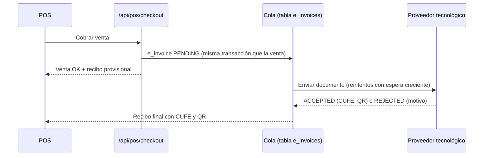

# Diseño: facturación electrónica DIAN y multi-sede

> Estado: **diseño documentado, sin implementar.** Ninguna de las dos aporta a una demo con datos
> ficticios: la DIAN exige una empresa y una resolución reales, y una sola droguería demo no
> necesita sedes. Este documento acota el trabajo para cuando haya un cliente real.

## 1. Facturación electrónica DIAN

### Cómo está hoy

El recibo (`/recibo/[id]`) es un **documento de demostración**: muestra el texto de la resolución
que la farmacia escribe en Configuración y la leyenda «no válido como factura electrónica».
No hay XML, firma ni envío a la DIAN.

### Propuesta

No firmar ni transmitir por cuenta propia: integrar un **proveedor tecnológico autorizado** por la
DIAN por API. Él genera el XML (UBL 2.1), lo firma, calcula el CUFE/CUDE, lo valida con la DIAN y
devuelve el estado y el código QR. Hacerlo directamente exige certificado digital, habilitación y
seguir los cambios del anexo técnico, que no es el negocio de una droguería.

- **La venta no espera a la DIAN.** Se cobra y se encola; un proceso aparte envía y reintenta.
  Si la DIAN o el proveedor están caídos, el mostrador sigue vendiendo.
- **Numeración** por resolución (prefijo, rango y vigencia) guardada por sede; se avisa antes de
  agotar el rango o de que venza.
- **Notas crédito** para los reembolsos, ligadas a la factura original.
- **Documento equivalente POS electrónico** para ventas sin datos del comprador, y factura
  electrónica cuando el cliente pide factura a su nombre (NIT/CC).

### Cambios en el esquema

- `e_invoices`: `sale_id`, `kind` (`POS` | `INVOICE` | `CREDIT_NOTE`), `number`, `cufe`, `status`,
  `provider_ref`, `attempts`, `last_error`, `qr_url`.
- `invoice_resolutions`: `branch_id`, `prefix`, `from`, `to`, `valid_until`, `next_number`.

## 2. Multi-sede

### Cómo está hoy

Un **tenant es una farmacia** con una sola sede. El selector de sede del menú existe, pero
`/api/auth/branches` devuelve solo la farmacia actual.

### Propuesta

Separar **empresa** (tenant: facturación del SaaS, usuarios, catálogo) de **sede** (inventario,
caja y ventas):

| Tabla | Cambio |
|---|---|
| `branches` (nueva) | `id`, `tenant_id`, `name`, `address`, resolución DIAN propia |
| `batches`, `stock_movements`, `cash_sessions`, `sales`, `purchases` | + `branch_id` |
| `products`, `patients`, `categories`, `suppliers` | sin cambio: compartidos por la empresa |
| `user_profiles` | + sedes permitidas (un cajero suele trabajar en una sola) |

- `requireAuth()` resolvería también la sede activa y validaría que el usuario tenga acceso.
- **Traslados entre sedes** como dos movimientos (`TRANSFER_OUT` / `TRANSFER_IN`) del mismo lote,
  para no perder la trazabilidad FEFO ([ADR 0001](adr/0001-fefo.md)).
- Los reportes y el dashboard filtran por sede o suman la empresa completa.
- Migración: crear una sede por farmacia existente y asignarle todas las filas actuales.

## Esfuerzo estimado

- DIAN con proveedor tecnológico: 1–2 semanas (integración, cola, notas crédito, pruebas en su sandbox).
- Multi-sede: 1 semana (migración, filtros por sede, traslados y permisos).
