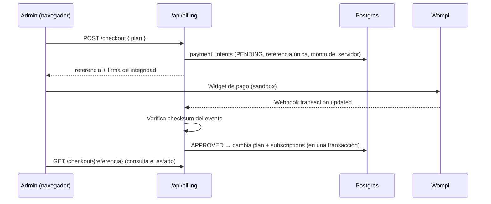

# Diseño: cobro del cambio de plan con pasarela (modo prueba)

> Estado: **diseño documentado, sin implementar.** Se decidió no conectar una pasarela real a la demo
> pública: no aporta a lo que se evalúa en el portafolio y obliga a manejar llaves y webhooks en producción.
> Este documento describe cómo se haría, para que la decisión quede justificada y el trabajo acotado.

## Cómo funciona hoy

`POST /api/billing/upgrade` cambia `pharmacies.plan_type` y crea una fila en `subscriptions` con estado
`ACTIVE` **sin cobrar nada**. Sirve para la demo, pero en un producto real cualquier administrador
obtendría un plan pago gratis.

## Pasarela elegida: Wompi (Colombia)

- Cobra en COP con tarjeta, PSE, Nequi y Bancolombia, y tiene **sandbox** con tarjetas de prueba.
- Alternativa evaluada: Mercado Pago (más países, pero el flujo de suscripciones es más pesado).

## Flujo propuesto



1. **El servidor fija el precio.** El navegador solo manda el plan; el monto sale de `PLAN_PRICES` en el
   servidor (igual que el POS no confía en el total del cliente).
2. **Firma de integridad.** `SHA-256(referencia + monto_en_centavos + "COP" + secreto_de_integridad)`
   se calcula en el servidor; el widget la exige, así nadie puede cambiar el monto en el navegador.
3. **El plan cambia solo por webhook.** La redirección del widget no prueba nada: el plan se activa cuando
   llega `transaction.updated` con estado `APPROVED` y el checksum del evento es válido
   (`SHA-256` de las propiedades indicadas en `signature.properties` + `timestamp` + secreto de eventos).
4. **Idempotencia.** La referencia es única; si Wompi reintenta el webhook, una transacción ya aplicada
   no vuelve a cambiar el plan ni a crear otra suscripción.
5. **Montos exactos.** El webhook compara `amount_in_cents` y moneda con el `payment_intent` guardado;
   si no coinciden, se marca `MISMATCH` y no se activa nada.

## Cambios en el esquema

```sql
create table payment_intents (
  id            uuid primary key default gen_random_uuid(),
  tenant_id     text not null references pharmacies(id),
  reference     text not null unique,
  plan          text not null,
  amount_cents  bigint not null,
  status        text not null default 'PENDING', -- PENDING | APPROVED | DECLINED | MISMATCH
  provider_tx   text,
  created_at    timestamptz not null default now(),
  updated_at    timestamptz not null default now()
);
```

## Variables de entorno

| Variable | Uso |
|---|---|
| `WOMPI_PUBLIC_KEY` | Widget en el navegador (`pub_test_…` en sandbox) |
| `WOMPI_INTEGRITY_SECRET` | Firma del monto (solo servidor) |
| `WOMPI_EVENTS_SECRET` | Verificación de webhooks (solo servidor) |

## Pruebas

- Unitarias: cálculo de la firma, verificación del checksum (válido, alterado, con propiedades en otro
  orden), idempotencia y monto distinto.
- E2E en sandbox: pago aprobado con la tarjeta de prueba y pago rechazado, verificando que el plan solo
  cambia en el primero.

## Esfuerzo estimado

2–3 días: endpoint de checkout, webhook con pruebas, migración y pantalla de estado del pago.
