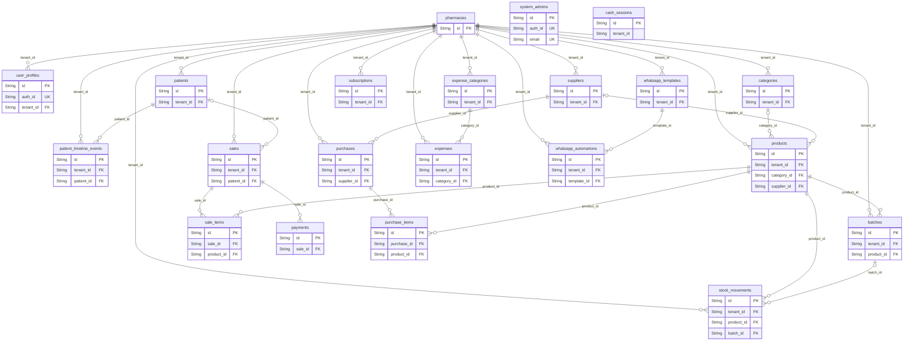

# Modelo de datos

> Generado desde `frontend/prisma/schema.prisma` con `npm run docs:erd`. No editar a mano.

21 tablas. Todas las de negocio llevan `tenant_id`: cada farmacia solo ve sus filas
(ver [ADR 0002](adr/0002-multi-tenant-rls.md)). El diagrama muestra las claves; la lista completa
de campos está debajo.

## Campos por tabla

### `pharmacies`

| Campo | Tipo | Notas |
|---|---|---|
| `id` | String | clave primaria |
| `name` | String |  |
| `tax_id` | String | opcional |
| `address` | String | opcional |
| `phone` | String | opcional |
| `subscription_id` | String | opcional |
| `status` | String |  |
| `plan_type` | String |  |
| `stripe_customer_id` | String | opcional |
| `trial_ends_at` | DateTime | opcional |
| `mrr_override` | Decimal | opcional |
| `settings` | Json | opcional |
| `created_at` | DateTime |  |
| `updated_at` | DateTime |  |

### `user_profiles`

| Campo | Tipo | Notas |
|---|---|---|
| `id` | String | clave primaria |
| `auth_id` | String | única |
| `tenant_id` | String | clave foránea |
| `first_name` | String |  |
| `last_name` | String |  |
| `role` | String |  |
| `created_at` | DateTime |  |
| `updated_at` | DateTime |  |

### `patients`

| Campo | Tipo | Notas |
|---|---|---|
| `id` | String | clave primaria |
| `tenant_id` | String | clave foránea |
| `first_name` | String |  |
| `last_name` | String |  |
| `phone` | String | opcional |
| `document_id` | String | opcional |
| `email` | String | opcional |
| `birth_date` | DateTime | opcional |
| `address` | String | opcional |
| `eps` | String | opcional |
| `blood_group` | String | opcional |
| `allergies` | String | opcional |
| `medical_notes` | String | opcional |
| `emergency_contact_name` | String | opcional |
| `emergency_contact_phone` | String | opcional |
| `status` | String |  |
| `last_purchase_date` | DateTime | opcional |
| `preferences` | Json | opcional |
| `tags` | String |  |
| `created_at` | DateTime |  |
| `updated_at` | DateTime |  |

### `patient_timeline_events`

| Campo | Tipo | Notas |
|---|---|---|
| `id` | String | clave primaria |
| `tenant_id` | String | clave foránea |
| `patient_id` | String | clave foránea |
| `user_id` | String | opcional |
| `event_type` | String |  |
| `event_data` | Json |  |
| `created_at` | DateTime |  |

### `suppliers`

| Campo | Tipo | Notas |
|---|---|---|
| `id` | String | clave primaria |
| `tenant_id` | String | clave foránea |
| `name` | String |  |
| `tax_id` | String | opcional |
| `email` | String | opcional |
| `phone` | String | opcional |
| `address` | String | opcional |
| `status` | String |  |
| `created_at` | DateTime |  |
| `updated_at` | DateTime |  |

### `categories`

| Campo | Tipo | Notas |
|---|---|---|
| `id` | String | clave primaria |
| `tenant_id` | String | clave foránea |
| `name` | String |  |
| `description` | String | opcional |

### `products`

| Campo | Tipo | Notas |
|---|---|---|
| `id` | String | clave primaria |
| `tenant_id` | String | clave foránea |
| `category_id` | String | clave foránea, opcional |
| `supplier_id` | String | clave foránea, opcional |
| `sku` | String |  |
| `barcode` | String | opcional |
| `brand_name` | String |  |
| `active_ingredient` | String | opcional |
| `presentation` | String | opcional |
| `unit_price` | Decimal |  |
| `cost_price` | Decimal | opcional |
| `min_stock` | Int |  |
| `created_at` | DateTime |  |
| `updated_at` | DateTime |  |

### `batches`

| Campo | Tipo | Notas |
|---|---|---|
| `id` | String | clave primaria |
| `tenant_id` | String | clave foránea |
| `product_id` | String | clave foránea |
| `batch_number` | String |  |
| `expiration_date` | DateTime |  |
| `quantity` | Int |  |

### `stock_movements`

| Campo | Tipo | Notas |
|---|---|---|
| `id` | String | clave primaria |
| `tenant_id` | String | clave foránea |
| `product_id` | String | clave foránea |
| `batch_id` | String | clave foránea, opcional |
| `user_id` | String |  |
| `movement_type` | String |  |
| `quantity` | Int |  |
| `reference_id` | String | opcional |
| `created_at` | DateTime |  |

### `sales`

| Campo | Tipo | Notas |
|---|---|---|
| `id` | String | clave primaria |
| `tenant_id` | String | clave foránea |
| `patient_id` | String | clave foránea, opcional |
| `cashier_id` | String |  |
| `subtotal` | Decimal |  |
| `tax_total` | Decimal |  |
| `discount_total` | Decimal |  |
| `grand_total` | Decimal |  |
| `status` | String |  |
| `payment_method` | String |  |
| `created_at` | DateTime |  |
| `updated_at` | DateTime |  |

### `sale_items`

| Campo | Tipo | Notas |
|---|---|---|
| `id` | String | clave primaria |
| `sale_id` | String | clave foránea |
| `product_id` | String | clave foránea |
| `batch_id` | String | opcional |
| `quantity` | Int |  |
| `unit_price` | Decimal |  |
| `subtotal` | Decimal |  |
| `tax_rate` | Decimal |  |
| `tax_amount` | Decimal |  |
| `total` | Decimal |  |

### `payments`

| Campo | Tipo | Notas |
|---|---|---|
| `id` | String | clave primaria |
| `sale_id` | String | clave foránea |
| `amount` | Decimal |  |
| `payment_method` | String |  |
| `reference_code` | String | opcional |
| `created_at` | DateTime |  |

### `purchases`

| Campo | Tipo | Notas |
|---|---|---|
| `id` | String | clave primaria |
| `tenant_id` | String | clave foránea |
| `supplier_id` | String | clave foránea |
| `user_id` | String |  |
| `invoice_number` | String | opcional |
| `total_amount` | Decimal |  |
| `status` | String |  |
| `created_at` | DateTime |  |
| `updated_at` | DateTime |  |

### `purchase_items`

| Campo | Tipo | Notas |
|---|---|---|
| `id` | String | clave primaria |
| `purchase_id` | String | clave foránea |
| `product_id` | String | clave foránea |
| `batch_number` | String | opcional |
| `expiration_date` | DateTime | opcional |
| `quantity` | Int |  |
| `unit_cost` | Decimal |  |
| `total_cost` | Decimal |  |

### `expense_categories`

| Campo | Tipo | Notas |
|---|---|---|
| `id` | String | clave primaria |
| `tenant_id` | String | clave foránea |
| `name` | String |  |
| `description` | String | opcional |
| `color` | String |  |
| `created_at` | DateTime |  |
| `updated_at` | DateTime |  |

### `expenses`

| Campo | Tipo | Notas |
|---|---|---|
| `id` | String | clave primaria |
| `tenant_id` | String | clave foránea |
| `category_id` | String | clave foránea |
| `user_id` | String | opcional |
| `amount` | Decimal |  |
| `date` | DateTime |  |
| `description` | String | opcional |
| `reference_code` | String | opcional |
| `status` | String |  |
| `created_at` | DateTime |  |
| `updated_at` | DateTime |  |

### `whatsapp_templates`

| Campo | Tipo | Notas |
|---|---|---|
| `id` | String | clave primaria |
| `tenant_id` | String | clave foránea |
| `name` | String |  |
| `content` | String |  |
| `variables` | Int |  |
| `is_active` | Boolean |  |
| `created_at` | DateTime |  |
| `updated_at` | DateTime |  |

### `whatsapp_automations`

| Campo | Tipo | Notas |
|---|---|---|
| `id` | String | clave primaria |
| `tenant_id` | String | clave foránea |
| `trigger_event` | String |  |
| `template_id` | String | clave foránea |
| `is_active` | Boolean |  |
| `created_at` | DateTime |  |
| `updated_at` | DateTime |  |

### `system_admins`

| Campo | Tipo | Notas |
|---|---|---|
| `id` | String | clave primaria |
| `auth_id` | String | única |
| `email` | String | única |
| `first_name` | String |  |
| `last_name` | String |  |
| `created_at` | DateTime |  |
| `updated_at` | DateTime |  |

### `subscriptions`

| Campo | Tipo | Notas |
|---|---|---|
| `id` | String | clave primaria |
| `tenant_id` | String | clave foránea |
| `plan_name` | String |  |
| `amount` | Decimal |  |
| `status` | String |  |
| `start_date` | DateTime |  |
| `end_date` | DateTime | opcional |
| `created_at` | DateTime |  |

### `cash_sessions`

| Campo | Tipo | Notas |
|---|---|---|
| `id` | String | clave primaria |
| `tenant_id` | String |  |
| `status` | String |  |
| `opened_by` | String |  |
| `opened_at` | DateTime |  |
| `opening_amount` | Decimal |  |
| `opening_denominations` | Json | opcional |
| `closed_by` | String | opcional |
| `closed_at` | DateTime | opcional |
| `cash_sales` | Decimal | opcional |
| `expected_amount` | Decimal | opcional |
| `counted_amount` | Decimal | opcional |
| `difference` | Decimal | opcional |
| `closing_denominations` | Json | opcional |
